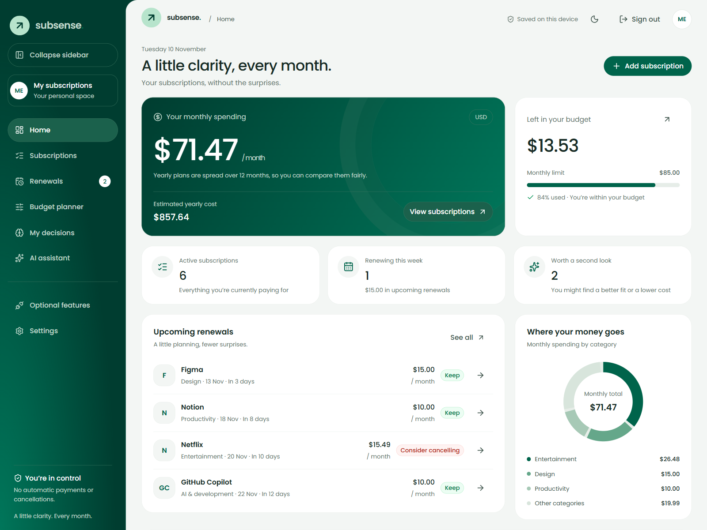
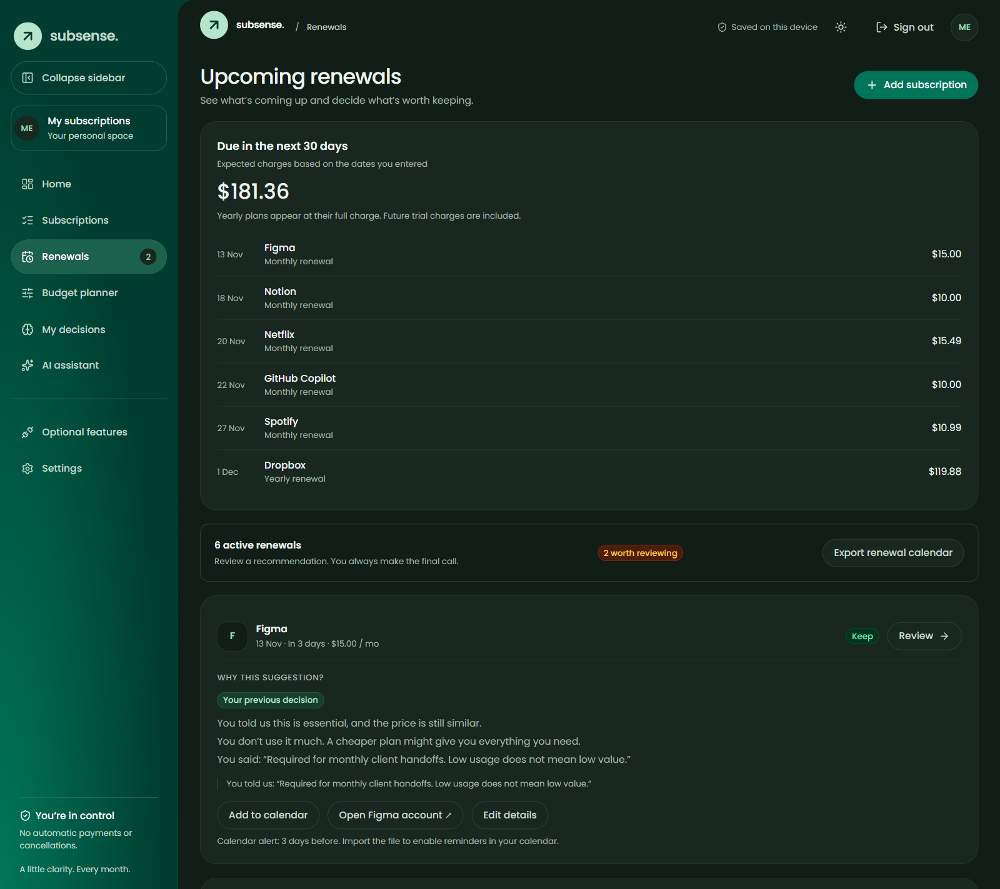

<p align="center"></p>

<h1 align="center">SubSense</h1>
<p align="center"><strong>A little clarity. Every month.</strong><br />Subscription decisions that remember what matters to you.</p>
<p align="center">Tatum × Walrus · Total Recall 2026 · Consumer Finance Apps</p>
<p align="center"><a href="docs/GUIDE.md">Product guide</a> · <a href="docs/SETUP.md">Setup & recovery</a> · <a href="docs/BLOG.md">Dev.to article</a> · <a href="docs/RELEASE.md">Verification status</a></p>


*Actual application screenshot with synthetic demonstration data. Screenshots are not evidence of live provider access or Mainnet writes.*

## Why SubSense

A rarely used subscription can still be essential. SubSense helps freelancers and creators see what is renewing, understand recurring costs, and remember **why** they kept or reconsidered a service.

The learning loop is explainable: a rarely used design tool initially gets cheaper-plan advice; a saved reason such as “required for client handoffs” changes it to keep. A price increase above 10% triggers a fresh review rather than repeating old advice blindly.

| Capability | What it does |
| --- | --- |
| Subscription tracking | Manual entry or reviewed CSV imports, monthly/annual plans, trials and renewal dates |
| Budget planning | USD commitments, upcoming full charges, temporary pause/downgrade previews |
| Contextual decisions | Keep, reconsider or plan to cancel; previous reasons inform the next recommendation |
| Wallet-specific recovery | Reopen the matching browser workspace and encrypted provider vault after signed login |
| Walrus Memory | Explicitly save selected decisions and recall relevant context from Mainnet |
| Tatum Sui reads | Read native SUI balances and verify existing transaction evidence; never send funds |
| Optional AI | Explain, plan and search selected context through allowlisted free OpenRouter models |

**You stay in control.** SubSense does not connect to a bank, cancel services, execute payments or autonomously change your budget. Decisions are notes; confirm billing changes with the provider before recording them.

## Quick start

Requirements: **Node.js 24 LTS**, npm and a Sui Mainnet-compatible wallet such as Slush.

```sh
npm ci
npm run setup:mainnet
npm run dev
```

Open **http://localhost:3000**, connect your wallet and approve **Confirm sign-in**. The personal message costs no gas and does not authorize spending. Home opens with an empty workspace; tracking works without provider credentials.

For optional online memory or AI, follow [Setup & recovery](docs/SETUP.md). The setup script creates `.env` only when absent and never replaces existing credentials.

### Verify and serve a public demo

```sh
npm run check
npm run build
npm start
```

`check` runs typechecking, automated tests, a production build and an isolated HTTP smoke test. Public deployments must set `SUBSENSE_PUBLIC_ORIGIN` to their exact HTTPS origin and serve built assets, not Vite development routes. Express and the frontend share one process and port 3000.

## Product tour


*Renewals explain their reasoning and surface your saved context. All illustrated records are synthetic.*

Use [the product guide](docs/GUIDE.md) for subscriptions, CSV imports, trial deadlines, calendar exports, follow-ups, budgets and backups. Both themes and responsive navigation are supported; motion respects reduced-motion preferences.

## Architecture

```text
React + TypeScript
  ├─ wallet-scoped workspace → browser storage / exported backup
  ├─ encrypted provider vault → browser Web Crypto
  └─ same-origin /api/subsense/*
       Express: verified wallet session + isolated in-memory credentials
         ├─ Tatum → Mainnet Sui GraphQL reads
         ├─ MemWal SDK → explicit Mainnet decision save / recall
         └─ OpenRouter → consented free-model advice / embeddings
```

| Directory | Responsibility |
| --- | --- |
| `src/subsense/` | Product UI, browser workspace, encrypted vault and API client |
| `shared/` | Validation, deterministic recommendations and financial calculations |
| `server/` | Single Express entry point, wallet authentication and provider adapters |
| `tests/` | Domain, security, integration, rendering and recovery regressions |
| `docs/` | User guide, setup, Dev.to article draft and current release evidence |

## Privacy and storage

- Workspace notes are **unencrypted browser-local data**, scoped to the signed-in wallet. Wallet scoping is not protection from someone or a script with access to your browser.
- Provider keys are stored as AES-256-GCM ciphertext, bound to wallet and Mainnet identity. The vault password never leaves the browser. Unlocked keys are sent to this app's backend for a 30-minute in-memory session.
- Sign-out, lock, expiry and server restart clear backend credentials, **not** saved browser workspaces or vaults. Reconnecting requires the same wallet, origin, browser profile and vault password.
- Export **workspace and encrypted-vault backups separately**. A new device needs both backups; Walrus decision memory is not a full workspace backup. Preserve the workspace profile ID to recover its remote namespace.
- Uploads require confirmation. The relayer processes decision plaintext before encrypted storage; AI receives only the question and selected, validated context. Never share secrets or private client details in public demonstrations.
- The AI Builder preview has no database or durable runtime storage. `/tmp` is ephemeral, and the served project directory is read-only.

## Submission and release status

**Recommended track: 03 — Consumer Finance Apps.** The [official Total Recall brief](https://tatum.io/hackathon/total-recall) explicitly includes subscription managers with learned spend limits. Consult the official brief for current submission requirements and awards; use [the Dev.to article draft](docs/BLOG.md) to explain the project.

Local automated verification passes. **Live owner-wallet compatibility, authenticated Mainnet Tatum reads, Walrus write/recall, 10+ completed memories and hosted deployment are not certified by these tests.** Record your real evidence before claiming eligibility. [Release status](docs/RELEASE.md) separates verified behavior from remaining owner tasks and dependency findings.

## Attribution

SubSense began from a friend's SpendGuard scaffold. Preserve that provenance and confirm the original author's reuse permission, preferred attribution and applicable licence before publishing. No permission or licence grant is invented here.

Visual direction was inspired by [Goodface's Emerald24 case study](https://www.behance.net/gallery/256834293/Neobank-web-mobile-app-UXUI-design-Emerald24); its artwork and branding are not included. SubSense's own mark and brand aliases sit over the supplied Tatum geometry tokens. Managed `.claude/skills/`, `.mcp.json` and `AGENTS.md` are retained as project tooling.
