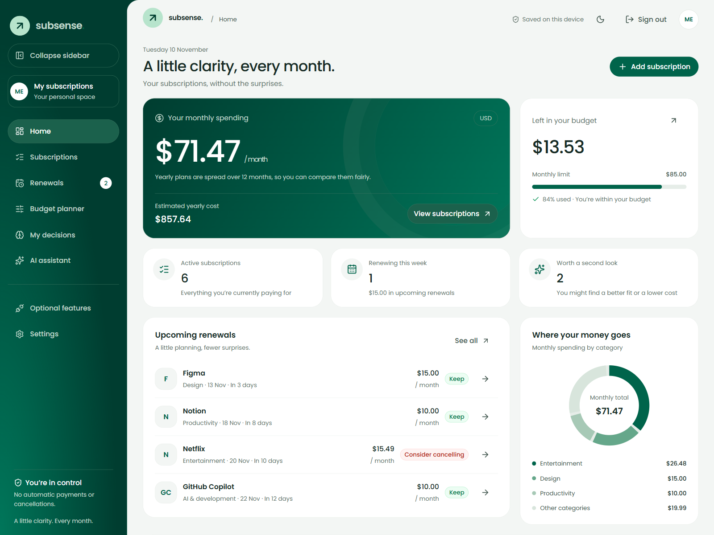
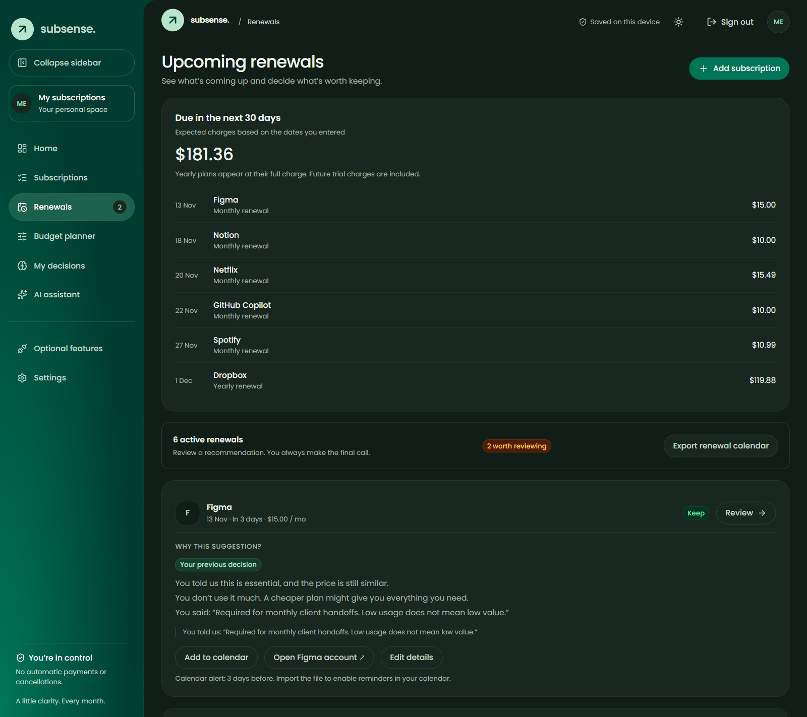
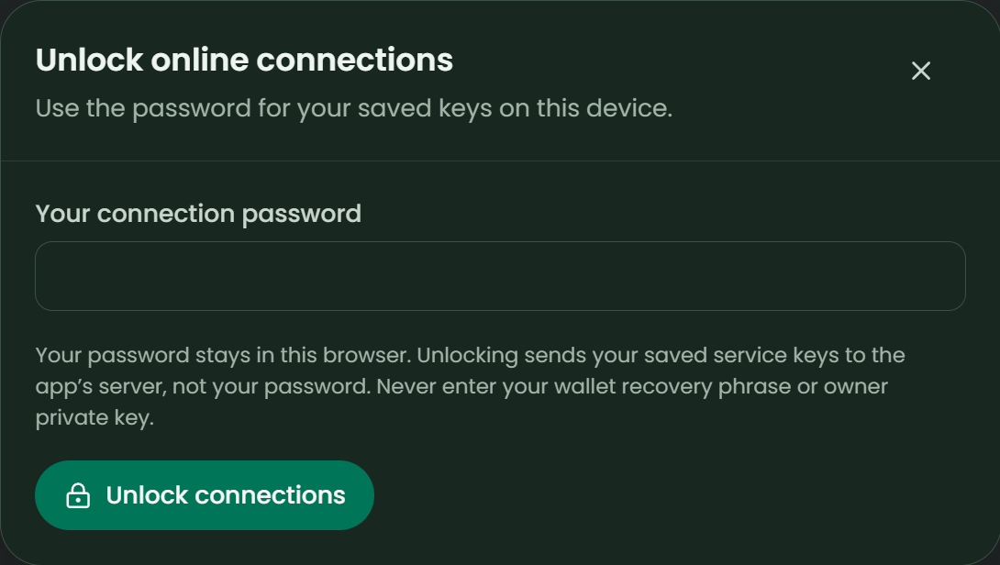

# Product guide

[README](../README.md) · [Setup & recovery](SETUP.md) · [Dev.to article](BLOG.md) · [Release status](RELEASE.md)

SubSense helps you track subscriptions and make informed renewal decisions. This guide uses synthetic examples; it does not represent actual billing accounts or Mainnet evidence.

## 1. See the monthly picture

Home shows active monthly commitments, estimated yearly cost, budget headroom and upcoming renewals. Annual subscriptions use monthly equivalents for comparison; the next-30-days forecast shows their **full charge**. Paused and cancelled services are excluded from active commitments. Update stale renewal dates before relying on forecasts.

## 2. Add subscriptions

Choose **Add subscription**, enter a service, USD price, billing cycle and renewal date. Service suggestions help with category and account links, never your price. Optional questions record usage, importance and whether a service supports work.

- **Free trials:** record the first paid date and future price; budgets include that future price. Confirm the first renewal to clear the trial marker.
- **Account links and reminders:** save the provider's management link, a cancellation deadline and your reminder interval.
- **CSV imports:** **Subscriptions → Import CSV** provides a template and review step. Required columns are `name,price,cadence,renewsOn`; prices use up to two USD decimal places, cadence is `monthly` or `annual`, and dates use `YYYY-MM-DD`. Imports are additive, flag duplicate names and enforce the 200-subscription limit.

## 3. Make a decision with context

Open **Renewals → Review**. Choose Keep, Cheaper plan, Plan to cancel or Decide later, then record a meaningful reason and value assessment.

For example, rare use initially suggests a cheaper plan. **Keep + Essential**, with “required for monthly client handoffs,” changes the next recommendation without changing the subscription's billing status or declared importance.

- The latest applicable reason informs advice for 180 days.
- A monthly-equivalent price increase over 10% requests a fresh review.
- Essential services remain protected; future and unrelated records are ignored.
- **Still true** reaffirms a reason; **Things changed** revises it. Correct usage or snooze the next review when needed.

**A decision is not a cancellation.** Planned cancellations and cheaper plans create local follow-ups. Open the provider account, make the actual change there, then record confirmed details in Edit.

## 4. Plan costs and reminders

The **Budget planner** previews pauses and lower prices without changing saved subscriptions. **Review & record** opens the regular edit form; proposed reductions require your confirmation. Previews clear when you leave or record a change.

Confirmed recurring reductions compare current prices with prices before your confirmed changes. They are **not cash saved to date**. Cancelling a free trial does not invent confirmed savings. Potential future costs avoided are shown separately.

**Renewals → Export calendar** downloads one-time `.ics` events. Import them into your calendar and check notification settings. Export again after changing dates and remove obsolete events. These are not background browser notifications or a synchronized feed; past dates are skipped.

## 5. Return to the right wallet

Connect the same Sui wallet and approve **Confirm sign-in**. Your subscriptions and previous decisions reappear from that wallet's browser storage. If a saved provider vault exists, Home offers **Unlock online connections**; enter its separate password. Another wallet sees its own workspace and cannot decrypt yours.

Local reasons are available without unlocking providers. Remote recall is explicit: unlock online memory, then use **Optional features → Online memory & payment tools → Find saved decisions**. See [recovery requirements](SETUP.md#recover-an-existing-workspace-and-vault) before moving devices or clearing browser data.

## 6. Keep recoverable backups

Use **Settings** to download a workspace backup. It contains subscription details and financial notes, **not provider keys**. Export an encrypted vault independently from **Optional features → Manage connection → Backups & connection security**.

- Backup reminders appear after five changes or when a changed backup is over 30 days old; snooze them for a week if needed.
- Download history records the request, not proof that the file was saved. Check the downloaded file yourself.
- Imports preserve the profile ID but strip remote receipts and payment evidence; recall or reverify them.
- Corrupt saved data is preserved. Export raw recovery data before explicitly replacing it in Settings.
- **Start my own workspace** replaces the current workspace only after confirmation and creates a new profile. Export the old profile first if its online memories matter.

## 7. Optional services

Walrus Memory stores selected renewal decisions, not a full subscription inventory. Tatum reads SUI balances and verifies existing native-SUI transactions. AI can explain or search selected context, but never acts on your behalf. Follow [Setup & recovery](SETUP.md) to connect these services safely.

## Navigation and appearance

Desktop supports an expanded sidebar or compact icon rail. Hover or keyboard focus reveals compact labels; **Keep expanded** pins the sidebar open. Mobile uses bottom tabs and **More**. The sun/moon control remembers this browser's appearance preference. Motion honors reduced-motion settings.
