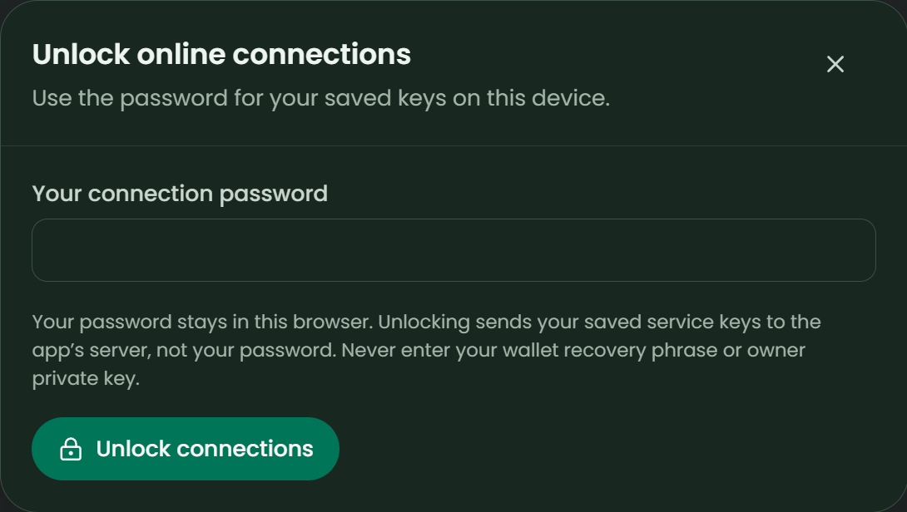

# Release verification

[README](../README.md) · [Product guide](GUIDE.md) · [Setup & recovery](SETUP.md) · [Dev.to article](BLOG.md)

**Review date: 10 November 2026.** This is a current evidence summary, not a production security certification. It replaces the obsolete chronological development diary.

## Automated verification

`npm run check` passes **90 tests**, TypeScript checking, the production build and an isolated production HTTP smoke test. Tests use generated unfunded signing wallets, injected provider mocks and local HTTP servers; they perform no real uploads, payments or inference.

| Area | Coverage |
| --- | --- |
| Product rules | Integer USD/SUI arithmetic, annual budgets, trials, actual upcoming charges, renewal dates and confirmed reductions |
| Learning | Latest relevant feedback, essential protection, 180-day relevance, >10% price-change review and duplicate recall merges |
| Recovery | Wallet-separated workspace/vaults, normalized wallet identities, corrupt-data preservation, backup imports and profile preservation |
| Credential vault | Fresh salt/IV, AES-GCM authentication, password/wallet/network/tamper rejection and legacy-provider handling |
| Wallet authentication | Verified personal-message signatures, one-time challenges, origin/expiry/replay rejection and HttpOnly sessions |
| Lifecycle isolation | Lock/logout/expiry cleanup, revocation during setup, stale response rejection including A → B → A, and secret redaction |
| Providers | Mainnet account/delegate checks, pinned endpoints, strict transaction evidence and completed-job-only receipts |
| AI | Explicit consent, selected-context bounds, free-only routing, privacy reset, tool denial, response validation and cache/rate limits |
| UI/serving | Representative rendered screens, missing-provider gates, built assets, disabled retired/dev APIs and request/body limits |

### Submission-review fixes

- Workspace storage now normalizes wallet addresses exactly as login and credential-vault storage do. Equivalent short, padded and mixed-case addresses reopen the same profile and prior reasons.
- The browser API records wallet generations. An A → B → A switch rejects results from A's earlier session instead of applying stale data or expiring the new session.
- Non-breaking dependency remediation updated the Express/qs tree. No forced Vite major upgrade was applied.

## Browser review and documentation captures

Documentation images capture the actual production UI using synthetic local data and a local-only generated-wallet fixture. Provider responses in that fixture are mocked; captures must never be presented as Mainnet eligibility evidence. The test fixture is not imported or served by `server/index.mjs`.

| Browser check | Observed result |
| --- | --- |
| Wallet A → B → A | B had no A subscriptions or vault prompt; A restored its original profile ID, service and reason with its vault still locked |
| Wrong / correct vault password | Wrong password preserved ciphertext and made no provider verification call; correct password unlocked without rewriting ciphertext |
| Reload recovery | The matching workspace, profile ID and saved reason remained available after reload |
| Explicit provider access | No automatic inference occurred during setup, wallet switching, unlock or reload; stored vault data contained neither the synthetic key nor password in plaintext |
| Learning interaction | Keep + Essential changed rare-use advice to Keep while leaving subscription importance and billing status unchanged |
| Responsive geometry | All eight screens at 390, 768 and 1440 CSS pixels in both themes: **48 checks, no document horizontal overflow** |
| Console after reload | No captured warnings or errors in the current document |

After rebuilding, Lighthouse scored **100 accessibility / 100 best practices / 100 SEO**, with no reported failures on the fixture's Home screen. This follows fixes for the account's accessible name, which now includes its visible **ME** label, and a real text `robots.txt` excluding API paths. Lighthouse is not a full accessibility, security or performance certification.

## Dependency and build findings

`npm audit` reports **2 remaining findings: 1 moderate and 1 high** in the inherited Vite/esbuild tree. Express/qs findings were resolved by compatible updates. Fully resolving the remaining findings requires a major Vite/tooling upgrade; do that as a separately tested change rather than forcing it into the submission build.

Serve public demos with `npm start` after building, and keep development private. Built-asset serving reduces development-route exposure but **does not constitute vulnerability remediation or a security audit**. The build also reports a >500 KB JavaScript chunk and an upstream pure-annotation warning; neither fails the build. Code-splitting remains a performance improvement, not a release test failure.

## Evidence still required from the owner

| Item | Status |
| --- | --- |
| Actual wallet-extension compatibility and signed owner login | Not independently verified in this review |
| Authenticated Mainnet Tatum balance/transaction query | Not independently verified; mocked schema coverage is not live compatibility |
| Actual Walrus account/delegate access, completed upload and recall after reconnect | Not independently verified |
| At least 10 meaningful, unique completed Mainnet memories | Requires genuine owner evidence; local/sample/pending records do not count |
| Authenticated OpenRouter inference with a real key | Not independently verified; optional, subject to quota/privacy availability |
| Hosted HTTPS demo and independent multi-user security review | Pending owner verification |
| Public repo, blog, demo video and submission | Owner publication/submission tasks |
| Scaffold reuse permission and applicable licence attribution | Must be confirmed before publishing |

Gather genuine Mainnet evidence and confirm the [official submission requirements](https://tatum.io/hackathon/total-recall) before publishing. Keep [the Dev.to article](BLOG.md) aligned with verified results. No Mainnet receipts, eligibility claims, licences or publication URLs are fabricated here.
