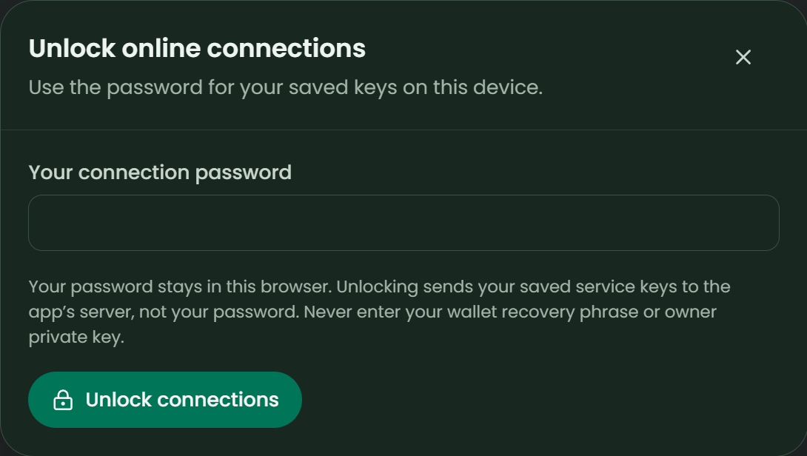

# Setup & recovery

[README](../README.md) · [Product guide](GUIDE.md) · [Dev.to article](BLOG.md) · [Release status](RELEASE.md)

Tracking works after signed wallet login. Online memory, Tatum reads and AI are optional. **All new blockchain operations are Mainnet only.** Never enter a recovery phrase or owner-wallet private key.

## Start locally

```sh
npm ci
npm run setup:mainnet
npm run dev
```

Use Node.js 24 LTS. Open **http://localhost:3000**, connect a Mainnet-compatible Sui wallet and select **Confirm sign-in**. Connection alone is not authentication: the backend verifies a one-time personal-message signature. No transaction, transfer or gas is involved.

Home opens first. Add subscriptions immediately, or open **Optional features** when you need providers.

## Connect Mainnet memory and Tatum

Choose **Optional features → Set up online memory**. You need:

| Field | Source and requirement |
| --- | --- |
| Tatum Mainnet API key | [Tatum API Keys](https://dashboard.tatum.io/api-keys); Mainnet key with Sui GraphQL access |
| MemWal Mainnet account object ID | [Walrus Memory dashboard](https://memory.walrus.xyz/); an existing account owned by the connected wallet, not a wallet/package/registry ID |
| MemWal delegate private key | An **Ed25519 delegate** already registered on that account; supported hex seed or `suiprivkey` format |

Use the [official account setup](https://docs.wal.app/walrus-memory/sdk/usage/memwal) and [delegate guide](https://docs.wal.app/walrus-memory/contract/delegate-key-management) if needed. Account creation and delegate registration are owner-controlled actions and may require SUI gas; SubSense does not perform them. A registration field asking for a public key must never receive a private key.

Create a separate, unique **12–256-character connection password**, confirm it and choose **Save & connect**. Setup checks account ownership, deployment, activation, delegate registration and signed metadata access. It does not upload decisions. Only verified encrypted credentials replace a saved vault; failed verification/restoration preserves the previous ciphertext. Browser-save failure clears the new backend credentials.

Endpoints are pinned to `https://sui-mainnet.gateway.tatum.io/graphql` and `https://relayer.memory.walrus.xyz`; there is no Testnet fallback or user-supplied upstream URL. Wallet sessions never borrow shared `.env` provider keys.

## Recover an existing workspace and vault



### Same browser and app origin

1. Connect the **same wallet** and approve **Confirm sign-in**.
2. The matching wallet's local subscriptions, decisions and profile ID reopen. Short/padded and mixed-case address representations use the same normalized identity.
3. Home detects saved ciphertext and offers **Unlock online connections**. Enter the original vault password; wallet connection does not decrypt credentials automatically.
4. Local decisions inform advice immediately. For remote memories, explicitly select **Find saved decisions** in the advanced online-memory tools after unlocking.

Sign-out, lock, session expiry and server restart remove backend keys but retain saved browser data. Switching wallets changes the workspace and vault; stale responses, including A → B → A switches, cannot be applied to a new session.

### New browser, origin or device

Browser storage does not synchronize. Before moving, export **both** the workspace backup and encrypted-vault backup:

1. Sign in with the original wallet at the destination.
2. Import its workspace in Settings and confirm the replacement. The backup's **profile ID must be preserved**: Walrus namespaces are profile-specific (`subsense-<profileId>`), not an account-wide inventory.
3. Load **Restore encrypted vault** under connection security, enter its original password and verify the selected providers. A mismatched wallet/password cannot unlock it.
4. Recall online decisions and reverify any payment evidence. Workspace import deliberately strips remote provenance.

No password recovery exists. Walrus cannot reconstruct your whole workspace, subscriptions or vault; semantic recall returns at most 50 relevant results. Creating a new workspace changes its namespace. If browser data was cleared without backups, this app does not offer automatic full recovery. The legacy unscoped workspace can only be imported explicitly in Settings; its original storage is not modified.

## Verify real memory without sending funds

1. Unlock the Mainnet connection and test providers in the advanced tools. Reachability alone is not completed storage or account access.
2. Save a meaningful decision using non-sample, synthetic demonstration data.
3. Choose **My decisions → Save online**, review the privacy notice and explicitly confirm. Each upload is a separate action and may carry provider costs.
4. An accepted job is **pending**. Use **Check online save** until the SDK returns `done` and a real blob ID. Pending jobs do not qualify as Mainnet memories.
5. Use **Find saved decisions**, then show the recovered reason changing advice. Export the workspace/profile and receipts before signing out.

If an upload times out, recall before retrying. Submissions use a profile/decision-scoped idempotency key. Keep a recovery job ID if browser receipt saving fails. The relayer processes plaintext before encrypted storage: do not upload secrets or private client notes.

Tatum can also check a SUI balance or verify an **existing** native-SUI transaction. Verification requires the exact digest, successful execution, complete balance changes, recipient net increase, UTC payment date and optional sender. Integer MIST arithmetic avoids float errors. This is transfer evidence, not proof of vendor billing recognition. USD budgeting remains separate; no funds are sent.

## Connect optional free AI

1. Create an [OpenRouter key](https://openrouter.ai/settings/keys).
2. Choose **Optional features → Set up AI help**. Leave all three blockchain fields empty for AI-only use, or include the complete Mainnet connection.
3. For an existing vault, export it first and use **Change connection keys**. Re-enter **every credential you want to retain**; this is full replacement, not partial editing.
4. Choose an allowlisted free chat model and **Save & connect**. Setup checks your key and current model catalogs without inference.
5. In **AI assistant**, select Ask, Explain, Plan renewals or Semantic search, select specific records, enter a question and confirm sharing for that request.

| Purpose | Pinned model |
| --- | --- |
| Default chat | `nvidia/nemotron-3.5-super-vl:free` |
| Alternative chat | `recursive/flint-v1.0:free` |
| Alternative chat | `xingchen-agi/xing4.0-29b-a4b:free` |
| Search embeddings | `nvidia/nemotron-3.5-embed-1b:free` |

Model availability, quota and permissions can change. Current zero pricing is rechecked during setup; a public listing is not proof that your key can perform inference. Only allowlisted `:free` IDs are accepted, all upstream price caps are zero, and paid fallbacks, tools, plugins and automatic retries are disabled.

Only the question and selected validated context are shared with OpenRouter and its model provider. Advice includes selected-subset totals/rules and the planning budget; wallet IDs, keys, payment evidence and receipts are excluded. References and similarity scores are not verified proof. Results are temporary and cannot change subscriptions or make payments.

Limits: 100 records, 1,000-character questions, 12 requests/minute and one in-flight AI request per wallet session. Embedding cache is session-local and bounded to 300 vectors. Lock, logout, expiry or restart clears it and backend keys.

AI generation and embedding requests wait up to 120 seconds for free-provider
queues or cold starts. Key and model-catalog checks retain their 45-second limit.
The browser allows 135 seconds for `/ai/run` so it can receive the server's
timeout response; other API requests retain their 60-second limit. Longer waits
do not guarantee provider availability, and requests never retry or switch models
automatically. After a timeout, try fewer records, a shorter question, or manually
choose another supported free model. Preserve/export an existing vault and
re-enter all credentials you want to retain when changing connection keys.

### Privacy controls

Strict routing uses `data_collection:deny`. Some free models have no endpoint satisfying this policy. No automatic privacy fallback is made, and zero retention is not promised.

For **synthetic demo data only**, an unchecked per-request option permits data-collecting providers, acknowledging possible retention/training. Select records and write the question first, enable this option only if you accept the tradeoff, then confirm the separate sharing checkbox. Both choices reset on completion, failure or context/access changes. Account privacy settings and guardrails can still block inference; the app cannot override them.

Older retired-provider vaults remain saved but require explicit replacement; old keys are never reinterpreted as OpenRouter keys. Blockchain-only vaults remain compatible.

## Hosting and environment

```sh
npm run build
npm start
```

Use one Express process, port 3000 by default. Set the following in the server environment before starting:

| Variable | Meaning |
| --- | --- |
| `SUBSENSE_NETWORK` | `mainnet`; wallet runtime rejects other networks |
| `SUBSENSE_PUBLIC_ORIGIN` | Exact origin, default `http://localhost:3000`; HTTPS required outside localhost |
| `PORT` | Optional listening port; also update the public origin for direct local access |
| `TATUM_API_KEY`, `MEMWAL_KEY`, `MEMWAL_ACCOUNT_ID` | Optional **server-only diagnostics**; never reused by wallet sessions |

An origin has no trailing slash, path or embedded credentials. POST origins must match exactly. Never use `VITE_*` variables for secrets, commit `.env`, expose development routes publicly or start a separate frontend server. The preview cannot persist a database or runtime files; its project directory is read-only and `/tmp` is ephemeral.

## Troubleshooting

| Symptom | Recommended action |
| --- | --- |
| Wallet missing / signature rejected | Install or update a Mainnet-compatible wallet; connect the intended account and sign a fresh challenge |
| 403 origin rejection | Open the exact configured public origin; fix the environment and restart |
| 401 session expiry | Sign in again, then unlock the saved vault |
| Previous workspace absent | Check wallet, origin and browser profile; import the original workspace backup rather than creating a new profile |
| Vault cannot unlock | Use its original wallet/password. Wrong-password failure preserves saved ciphertext |
| Account missing / owner mismatch | Use a real Mainnet account object ID owned by the connected wallet |
| Delegate rejected / inactive account | Register the correct public delegate key or resolve activation in Walrus Memory, then reconnect |
| Tatum schema/authentication failure | Check Mainnet key scope, Sui GraphQL access and live gateway compatibility; never switch to Testnet silently |
| No recalled results | Check the original profile ID/account, broaden the query and verify completed writes; recall is bounded |
| Storage unavailable or corrupt | Preserve raw recovery data; do not clear storage without backups |
| AI `PRIVACY_BLOCKED` | Keep strict privacy, or explicitly opt in for synthetic data only after reviewing provider/account policies |
| AI `KEY_REJECTED` / `ACCESS_BLOCKED` / `ACCOUNT_LIMIT` | Check active key, model permissions, quotas and guardrails; do not add credits to bypass a free-only app error |
| AI `FREE_QUOTA` / provider unavailable | Inspect usage and retry later manually; failed requests may consume quota |
| AI request timeout | Restart/redeploy the current server and frontend for the 120-second inference allowance; try fewer records, a shorter question or another supported free model manually |
| AI output/context rejection | Reduce context or try another supported chat model; no tools or paid fallback are enabled |

`npm run diagnose:walrus` is a read-only owner-run check using optional `.env` diagnostic credentials, not your browser vault. `npm run test:connections` identifies wallet mode; it cannot access your HttpOnly login cookie. Share only sanitized errors, never keys, passwords or private notes.
